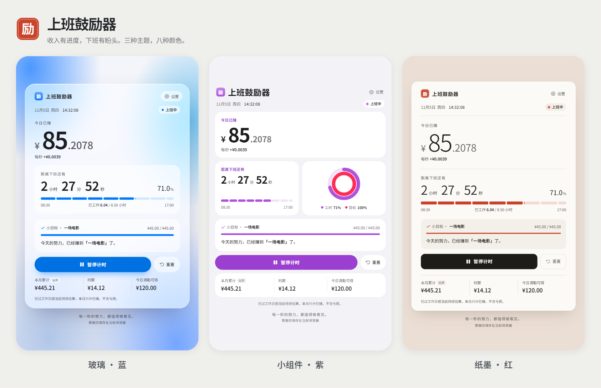
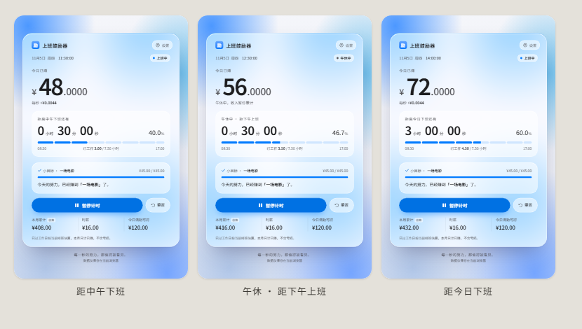
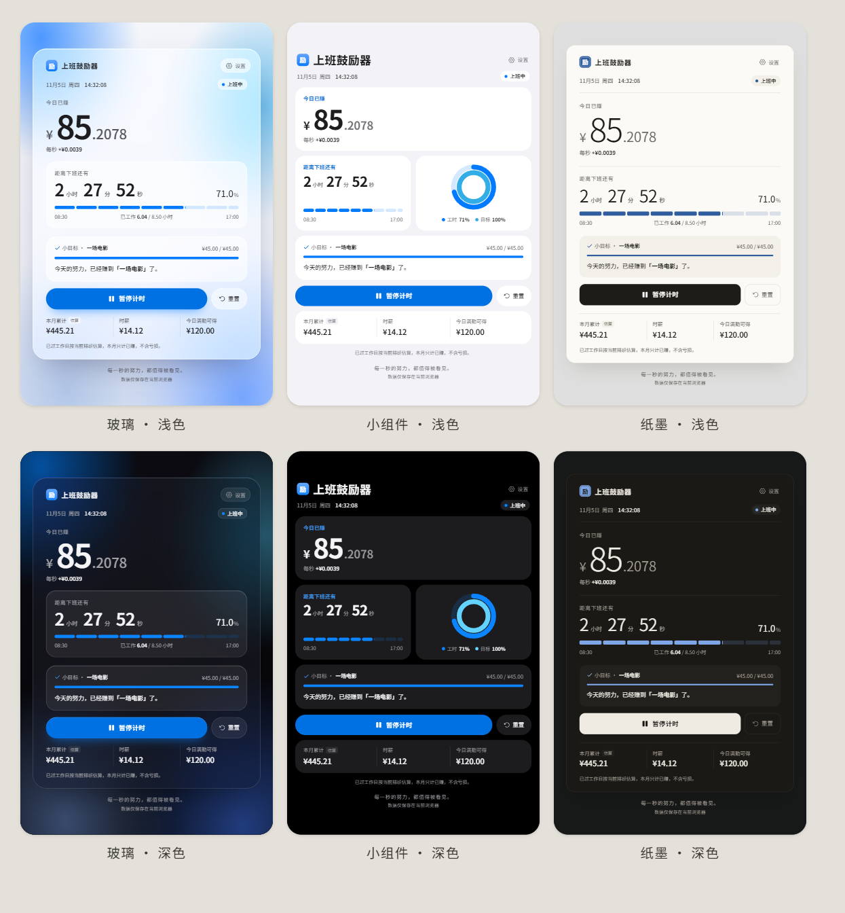
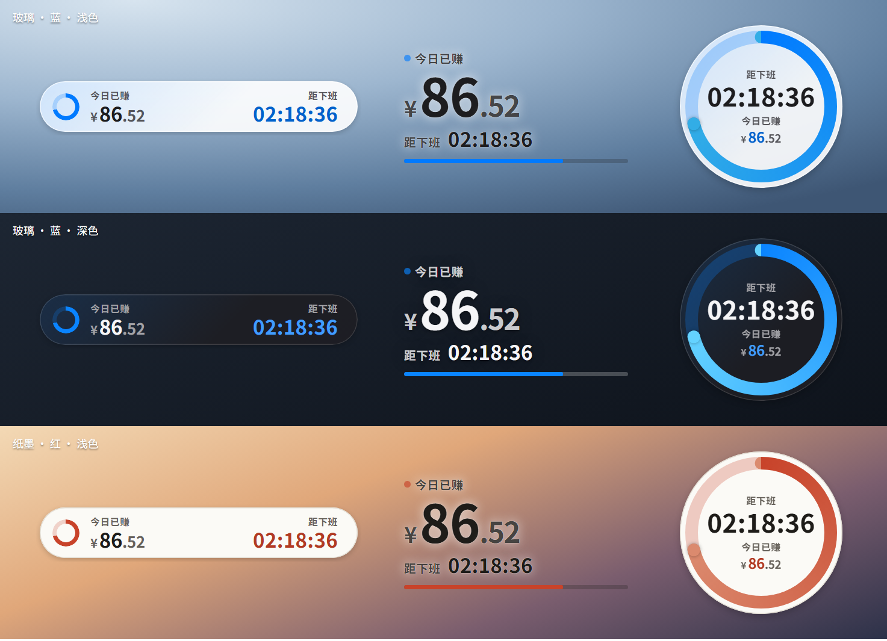
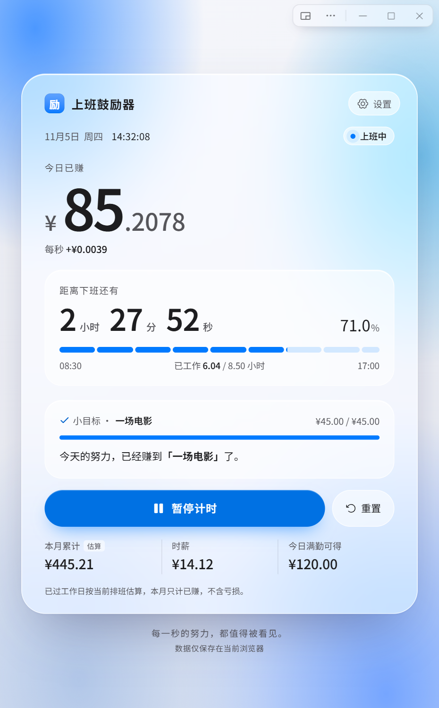

<div align="center">
  
  <h1>Work Cheer · 上班鼓励器</h1>
  <p>How much have you earned today? How long until you clock out?</p>
  <p>Real-time earnings · Midday segmented countdown · Three desktop floating widgets · Holidays & makeup workdays</p>
  <p>
    <a href="https://github.com/ShepiTT/work-cheer/releases/latest">Download Latest</a> ·
    <a href="#screenshots">Screenshots</a> ·
    <a href="#local-development">Local Development</a> ·
    <a href="docs/DEVELOPMENT.md">Developer Guide</a>
  </p>
  <p>
    <a href="README.md">🇨🇳 简体中文</a>
  </p>
</div>



An offline-capable work progress tracker. Enter your salary and work schedule, then watch your earnings accumulate in real time and see how long until you can clock out. Available as a browser app, single-file offline HTML, and Windows portable software.

## Download & Usage

Current version: **1.13.0**

| Edition | Download | Usage |
| --- | --- | --- |
| Windows Full | [Full ZIP](https://github.com/ShepiTT/work-cheer/releases/download/v1.13.0/work-cheer-1.13.0-windows-full-x64.zip) | EXE 102.7 MB, bundled Electron runtime, extract and run |
| Windows Lite | [Lite ZIP](https://github.com/ShepiTT/work-cheer/releases/download/v1.13.0/work-cheer-1.13.0-windows-lite-x64.zip) | EXE 1.8 MB, requires Edge WebView2 and .NET Framework 4.8, extract and run |
| Offline HTML | [Offline Web ZIP](https://github.com/ShepiTT/work-cheer/releases/download/v1.13.0/work-cheer-1.13.0-offline-web.zip) | Extract and open `上班鼓励器.html` in browser |
| Source Code | [Download Source](https://github.com/ShepiTT/work-cheer/archive/refs/heads/main.zip) | See Local Development below |

Both Windows editions are x64. The Lite edition reuses the main interface but renders floating widgets natively; automated checks have passed, though real mouse dragging, resizing, context menus, and tray interactions still await user verification. On first launch, the Lite edition attempts to copy data from the Full edition; afterwards each saves separately and does not auto-sync.

SHA-256 checksums are available in the [Release attachments](https://github.com/ShepiTT/work-cheer/releases/tag/v1.13.0). Windows editions are unsigned portable software. The app runs fully offline and requires no account registration.

1. Open Settings and enter your daily or monthly salary, work hours, and lunch break schedule.
2. To count down separately to midday break and end-of-day, enable **Midday Segmented Countdown** under Settings → Salary & Schedule, then fill in "Midday Off" and "Afternoon Start" times.
3. Review the work calendar according to your company's actual schedule; official holidays and makeup workdays can be applied automatically, or you can override individual dates manually.
4. On Windows, click the floating widget button in the top-right corner to keep earnings and countdown visible on your desktop.

Before upgrading, quit the old version from the tray or the ⋯ menu in the top-right corner, then launch the new version. Your salary settings, records, and floating widget positions will carry over. If the old version is still running, double-clicking the new version will bring back the old window.

## Screenshots

### Morning waits for midday off, lunch break waits for afternoon start

Version 1.13.0 adds an optional **Midday Segmented Countdown**: in the morning it shows "Until midday off", during lunch it shows "Until afternoon start", and in the afternoon it shows "Until end of day"; before work hours it shows "Until work starts". The main interface and all three Windows floating widget styles switch in sync.

Enable "Midday Segmented Countdown" under **Settings → Salary & Schedule** and fill in "Midday Off" and "Afternoon Start" times. Existing settings default to off; once enabled, your existing lunch break times are used. **Whether lunch break deducts from earnings is still controlled separately by "Deduct Lunch"**; pausing earnings does not pause the schedule countdown.



### Eight themes, each with its own layout

**Glass** uses frosted cards with colorful backgrounds; **Widgets** adopts a modular layout with activity rings; **Zhimo** (Paper & Ink) keeps paper whitespace and ink-colored text. Version 1.10.0 added **Pixel** (dot-matrix digits with 8-bit borders), **Cyberpunk** (neon clipped panels), **Y2K** (late-'90s gray windows), **Clay** (soft rounded 3D controls), and **LCD** (seven-segment digits with glowing screens). Beyond themes, you can independently choose from eight accent colors — blue, purple, pink, red, orange, yellow, green, and graphite — plus light mode, dark mode, or follow system.



### Desktop floating widgets — just two things

Three shapes: **Minimal Capsule, Transparent Floating Text, Countdown Ring**. Since version 1.12.0 you can choose a separate **Floating Widget Theme**: follow the main window (default), or pick any of the eight themes (Glass, Widgets, Zhimo, Pixel, Cyberpunk, Y2K, Clay, LCD) independently, giving you **3 styles × 8 themes = 24 combinations**. For example, use Glass for the main window and Pixel for the floating widget; accent color and light/dark appearance still follow the main window.

Pixel has clipped corners with block progress, Cyberpunk has neon clipped edges with segmented rings, Y2K uses retro windows with 3D pie charts, Clay uses soft 3D panels, and LCD uses seven-segment digits with graduated screens. They show only today's earnings, countdown to clock-out, and work progress.



- Drag by holding the earnings amount, countdown, or any visible background; each of the three styles remembers its own position.
- Right-click → **Floating Style** to choose shape; right-click → **Floating Theme** to choose appearance. The same options are available from the tray and the ⋯ menu in the top-right corner.
- Press `Esc` or click Settings to return to the full window; the selected floating theme persists after restart.
- Floating widgets stay always-on-top; the full window's size, maximized state, and always-on-top preference are saved independently.

### Custom Windows title bar

The top-right corner has floating widget, more menu, minimize, maximize, and close buttons; the top bar and areas outside cards can be dragged. The more menu includes transparency, always-on-top, tray, and zoom settings.



All images above are actual app renders or isolated previews using demo salary data at fixed times; they do not represent real earnings.

## Features

| Feature | Description |
| --- | --- |
| Real-time Earnings | Daily or monthly salary mode; shows today's earnings and per-second progress based on effective work time |
| Countdown | Optionally counts down to midday off, afternoon start, or end of day; supports pre-work, rest day, and already clocked out states |
| Work Progress | Current work duration, daily progress, hourly rate, and estimated monthly total |
| Mini Goals | Set target amounts for movies, coffee, etc., and see what today's earnings can buy |
| Pause & Reset | Pausing stops earnings accumulation while countdown continues; reset affects only the current day |
| Holidays & Makeup Days | Built-in 2026 mainland China official schedule; supports manual per-day overrides |
| Appearance | 8 themes × 8 colors; supports light, dark, and auto modes |
| Windows Features | 3 floating widget styles × 8 independent themes, custom title bar, tray, always-on-top, transparency, position memory |
| Local Storage | Salary, schedule, and records are saved in your current browser or local account; no cloud sync |

## Calendar & Calculation Rules

Each date is determined in this priority order: **manual override → enabled official schedule → weekly pattern**. Makeup workdays and holidays affect effective work hours, monthly salary proration, pause deductions, and monthly totals.

- The current built-in year is **2026**: 33 holiday dates and 6 makeup workdays, from the [official State Council notice](https://www.gov.cn/zhengce/zhengceku/202511/content_7047091.htm).
- For years without built-in data, weekly patterns and manual adjustments apply, with a coverage notice displayed.
- Monthly salary is not directly reduced for regular holidays; progress is calculated by prorating across the final count of workdays in the month.
- Only same-day shifts are supported; overnight shifts are not yet available.

Earnings and totals are estimates based on your settings, not actual payroll or attendance results. The website, offline HTML, and Windows software each save data separately and do not auto-sync.

## Local Development

Requires Node.js 22 or later and npm. Windows packaging must be done on Windows x64.

```bash
git clone https://github.com/ShepiTT/work-cheer.git
cd work-cheer
npm run setup
npm run dev
```

Development preview: `http://127.0.0.1:4173`

```bash
npm test                 # Build web, run calculation and site adaptation checks
npm run build:offline    # Generate outputs/上班鼓励器.html
npm run build:desktop    # Build offline HTML first, then package Windows portable EXE
npm run smoke:desktop    # Check final EXE with isolated test data directory
```

```text
work/
  work-cheer/            React web app, calculation rules, calendar, themes, tests
  work-cheer-desktop/    Electron window, floating widgets, tray, packaging
  work-cheer-lite/       C# + WebView2 lite edition
  third_party/          WebView2 SDK build components and licenses
docs/
  images/               README screenshots
  DEVELOPMENT.md        Build sequence, data compatibility, validation boundaries
  CHANGELOG.md          Current version notes
```

For complete build steps and data formats, see [Developer Guide](docs/DEVELOPMENT.md). The repository includes GitHub Actions for web builds and tests; Windows packages have separate local isolated launch checks. There is currently no public online demo; for browser use, download the offline version or run locally.

## License & Acknowledgments

This project's code is licensed under the [MIT License](LICENSE). Third-party code, fonts, and runtimes distributed with the software follow their respective licenses; see [Third-Party Notices](THIRD_PARTY_NOTICES.md).

- [WizzenH/xindong](https://github.com/WizzenH/xindong): Reference for monthly salary calendar, themes, and desktop interactions; [MIT notice](work/work-cheer/public/licenses/xindong-MIT.txt) retained.
- Noto Sans SC: Interface font and "励" (encourage) seal glyph; [SIL OFL 1.1](work/work-cheer/public/fonts/OFL.txt) retained.
- React, Electron, Phosphor, and other dependencies: Corresponding licenses retained with build artifacts.

For issues, please open an [Issue](https://github.com/ShepiTT/work-cheer/issues) with your version, reproduction steps, and screenshots. Please redact your salary or other personal information.
