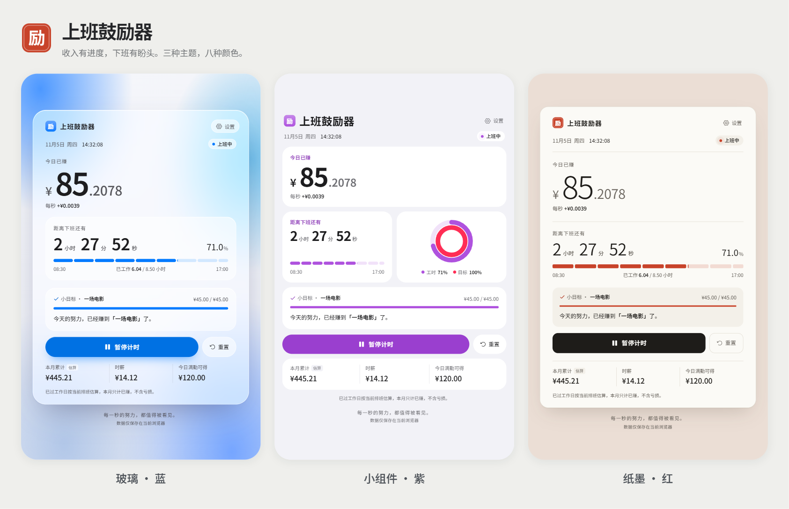
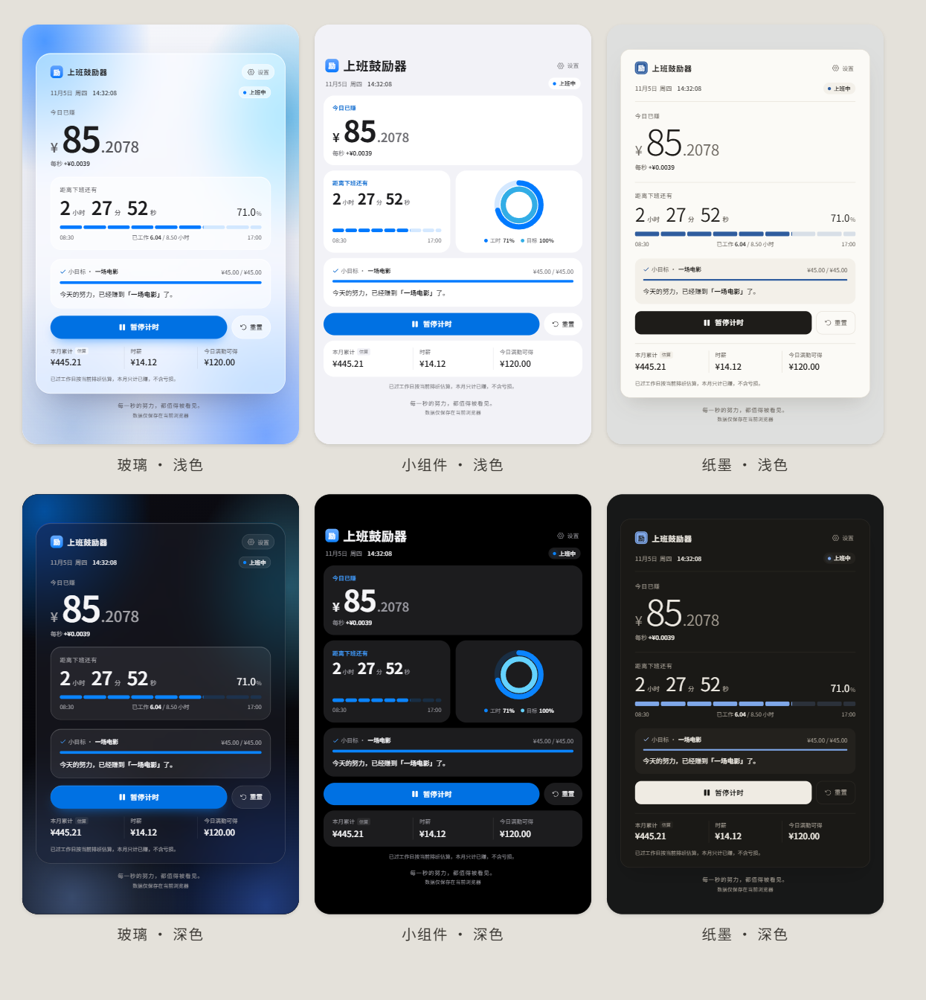
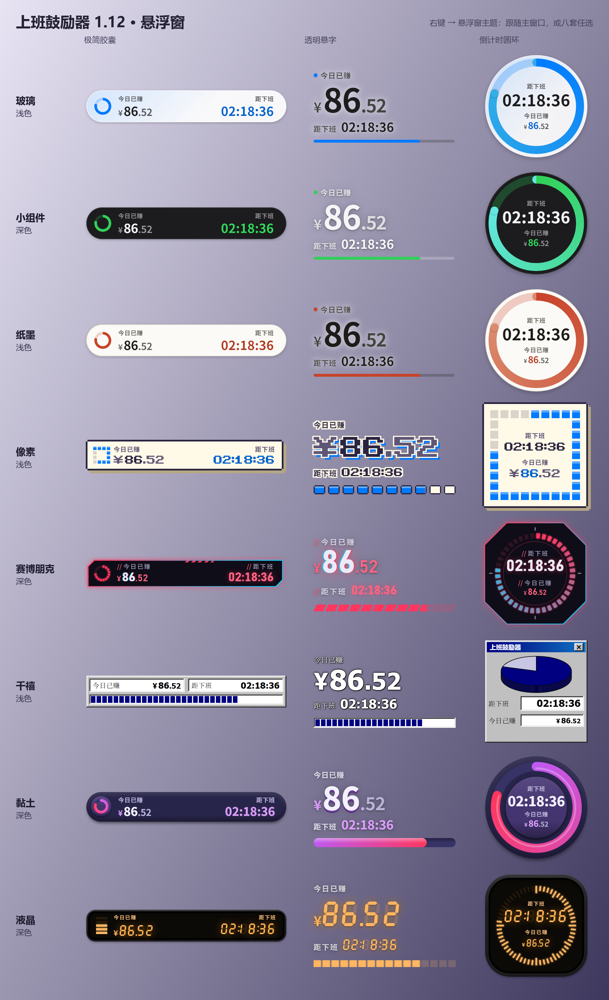
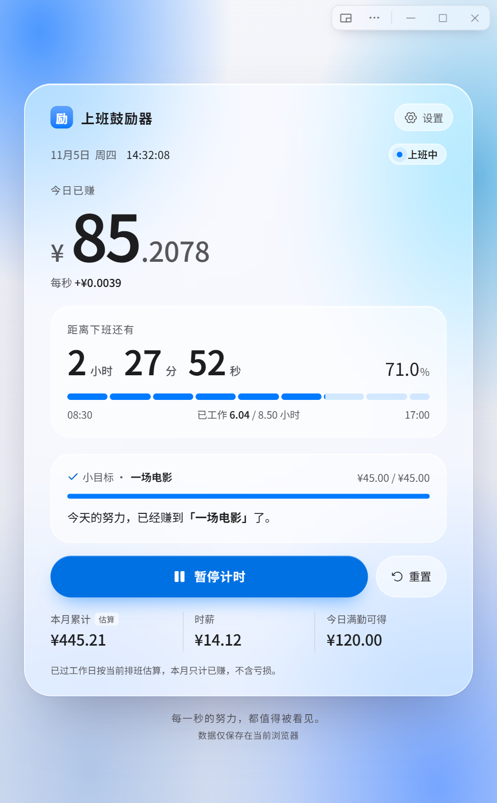

<div align="center">
  
  <h1>上班鼓励器 · Work Cheer</h1>
  <p>今天赚了多少钱，距离下班还有多久。</p>
  <p>实时收入进度 · 下班倒计时 · 三款桌面悬浮窗 · 放假调休</p>
  <p>
    <a href="https://github.com/ShepiTT/work-cheer/releases/latest">下载最新版</a> ·
    <a href="#界面预览">看界面</a> ·
    <a href="#本地开发">本地开发</a> ·
    <a href="docs/DEVELOPMENT.md">开发说明</a>
  </p>
</div>



一款可以离线使用的工作进度小工具。输入工资和作息后，看看今天已经积累了多少收入，也看看距离下班还有多远。提供浏览器版、单文件离线网页和 Windows 便携软件。

## 下载与使用

当前版本：**1.12.0**。

| 版本 | 下载 | 使用方式 |
| --- | --- | --- |
| Windows 完整版 | [完整版 ZIP](https://github.com/ShepiTT/work-cheer/releases/download/v1.12.0/work-cheer-1.12.0-windows-full-x64.zip) | EXE 102.7 MB，自带 Electron 内核，解压运行 |
| Windows 轻量版 | [轻量版 ZIP](https://github.com/ShepiTT/work-cheer/releases/download/v1.12.0/work-cheer-1.12.0-windows-lite-x64.zip) | EXE 1.8 MB，依赖系统 Edge WebView2 和 .NET Framework 4.8，解压运行 |
| 单文件离线网页 | [离线网页版 ZIP](https://github.com/ShepiTT/work-cheer/releases/download/v1.12.0/work-cheer-1.12.0-offline-web.zip) | 解压后用浏览器打开 `上班鼓励器.html` |
| 源码 | [下载源码](https://github.com/ShepiTT/work-cheer/archive/refs/heads/main.zip) | 参考下方本地开发步骤 |

两个 Windows 版本均为 x64。轻量版复用主界面，悬浮窗采用原生绘制；自动检查已通过，真实鼠标拖动、缩放、菜单与托盘仍待用户试用。轻量版首次启动尝试复制完整版数据，之后各自保存、不自动同步。

下载文件的 SHA-256 校验值见 [Release 附件](https://github.com/ShepiTT/work-cheer/releases/tag/v1.12.0)。Windows 版为未签名便携软件；软件运行无需联网，也不需要注册账户。

1. 打开设置，填写日薪或月薪、上下班时间和午休安排。
2. 按公司实际情况检查工作日历；国家放假和调休补班可自动纳入，也可以手动改单个日期。
3. Windows 版点击右上角的悬浮窗按钮，让收入和倒计时留在桌面上。

升级前先从托盘或右上角 ⋯ 菜单退出旧版，再打开新版；工资、记录和悬浮窗位置会沿用。旧版仍在运行时，双击新版会唤回旧窗口。

## 界面预览

### 八种主题，每种都有自己的布局

**玻璃**用磨砂卡片和彩色背景；**小组件**采用模块布局和活动圆环；**纸墨**保留纸面留白与墨色文字。1.10.0 新增 **像素**（点阵数字与八位机边框）、**赛博朋克**（霓虹切角面板）、**千禧**（上世纪末的灰色窗口）、**黏土**（柔软圆润的立体控件）和 **液晶**（数码管数字与发光屏）。主题之外，可以独立选择蓝、紫、粉、红、橙、黄、绿、石墨八种颜色，以及浅色、深色或跟随系统。



### 桌面悬浮窗，只留下两件事

三种形状：**极简胶囊、透明悬字、倒计时圆环**。1.12.0 起可单独选 **悬浮窗主题**：跟随主窗口（默认），或从玻璃、小组件、纸墨、像素、赛博朋克、千禧、黏土、液晶中任意选一套，形成 **3 种样式 × 8 套主题 = 24 种搭配**。例如主窗口用玻璃、悬浮窗用像素；颜色与浅深外观仍跟随主窗口。

像素有缺角边框与方块进度，赛博朋克有霓虹切角与分段圆环，千禧用复古窗口与立体饼图，黏土用柔软立体面板，液晶用数码管和刻度屏。只显示今日收入、下班倒计时及工时进度。



- 按住金额、倒计时或可见背景拖动；三款分别记住位置。
- 右键 → **悬浮窗样式** 选形状，右键 → **悬浮窗主题** 选外观；托盘和右上角 ⋯ 菜单也有同样入口。
- 进入设置或按 `Esc` 回到完整窗口；所选悬浮窗主题重启后保留。
- 悬浮窗保持置顶，完整窗口的大小、最大化和置顶偏好独立保存。

### 无系统标题栏的 Windows 窗口

右上角集中放置悬浮窗、更多菜单、最小化、最大化和关闭按钮；顶部与卡片外空白可以拖动。更多菜单保留透明度、置顶、托盘、缩放等设置。



以上图片均为应用实际渲染或隔离预览，使用演示工资与固定时间，不代表真实收入。

## 功能

| 功能 | 说明 |
| --- | --- |
| 实时收入 | 日薪或月薪模式，按有效工作时长显示今日收入与每秒进度 |
| 下班倒计时 | 以时、分、秒展示剩余时间，支持上班前、午休、休息日和已下班状态 |
| 工作进度 | 当前已工作时长、当日进度、时薪和本月估算累计 |
| 小目标 | 设置电影、咖啡等目标金额，查看今天的积累可以换来什么 |
| 暂停和重置 | 暂停期间不累计收入，倒计时继续；重置只影响当天 |
| 放假与调休 | 内置 2026 年中国大陆官方安排，支持单日手动覆盖 |
| 外观 | 八种主题 × 八种颜色，支持浅色、深色和自动 |
| Windows 交互 | 3 种悬浮窗样式 × 8 套独立主题、自绘标题栏、托盘、置顶、透明度、位置记忆 |
| 本地保存 | 工资、作息和记录保存在当前浏览器或本机账户，无云端同步 |

## 日历与计算口径

单个日期按 **手动修改 → 已启用的国家安排 → 每周规律** 的顺序判定。补班和假期同时影响有效工时、月薪分摊、暂停扣除和月累计。

- 当前内置年份为 **2026**：33 个放假日期、6 个补班日期，来自[国务院办公厅官方通知](https://www.gov.cn/zhengce/zhengceku/202511/content_7047091.htm)。
- 未内置年份使用每周规律及手动调整，并显示覆盖范围提示。
- 月薪总额不因正常假期直接扣减，按当月最终工作日分摊计算进度。
- 仅支持同日班次，暂不支持跨夜上下班。

收入和累计均为按设置计算的估算，不是工资结算或考勤结果。网站、离线网页与 Windows 软件各自保存数据，彼此不自动同步。

## 本地开发

需要 Node.js 22 或更高版本及 npm。Windows 打包请在 Windows x64 环境执行。

```bash
git clone https://github.com/ShepiTT/work-cheer.git
cd work-cheer
npm run setup
npm run dev
```

开发预览地址：`http://127.0.0.1:4173`。

```bash
npm test                 # 构建网页，运行计算和网站适配检查
npm run build:offline    # 生成 outputs/上班鼓励器.html
npm run build:desktop    # 先生成离线网页，再打包 Windows 便携 EXE
npm run smoke:desktop    # 用独立测试资料目录检查最终 EXE
```

```text
work/
  work-cheer/            React 网页、计算规则、日历、主题、测试
  work-cheer-desktop/    Electron 窗口、悬浮窗、托盘、打包
  work-cheer-lite/       C# + WebView2 轻量版
  third_party/          WebView2 SDK 构建组件及许可
docs/
  images/               README 界面图片
  DEVELOPMENT.md        构建顺序、数据兼容和验证边界
  CHANGELOG.md          当前版本说明
```

更完整的构建步骤和数据格式见[开发说明](docs/DEVELOPMENT.md)。仓库附带网页构建与测试的 GitHub Actions；Windows 包另有本地隔离启动检查。当前没有新版的公共在线演示，浏览器使用可下载离线版或本地运行。

## 许可与致谢

本项目代码采用 [MIT License](LICENSE)。随软件分发的第三方代码、字体和运行时分别遵循各自许可，见[第三方许可说明](THIRD_PARTY_NOTICES.md)。

- [WizzenH/xindong](https://github.com/WizzenH/xindong)：月薪日历、主题和桌面交互参考，保留 [MIT 声明](work/work-cheer/public/licenses/xindong-MIT.txt)。
- Noto Sans SC：界面字体和“励”字印章字形，保留 [SIL OFL 1.1](work/work-cheer/public/fonts/OFL.txt)。
- React、Electron、Phosphor 等依赖：对应许可随构建产物保留。

如有问题，欢迎在 [Issues](https://github.com/ShepiTT/work-cheer/issues) 中附上版本、复现步骤和截图；请遮住自己的工资或其他个人信息。
